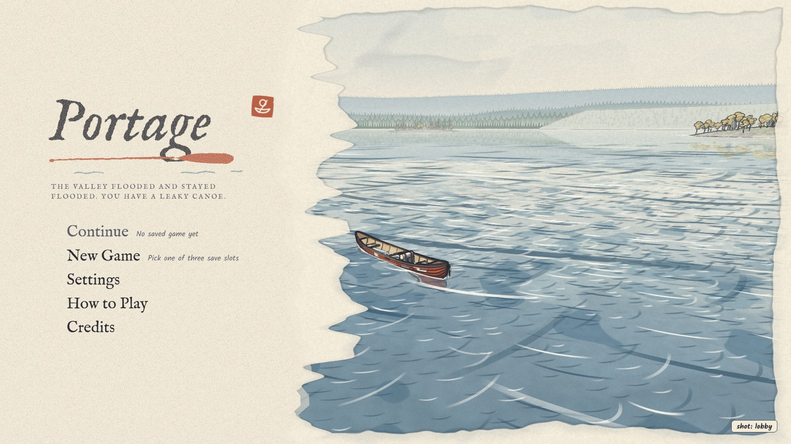
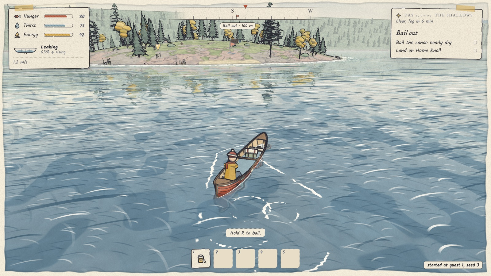
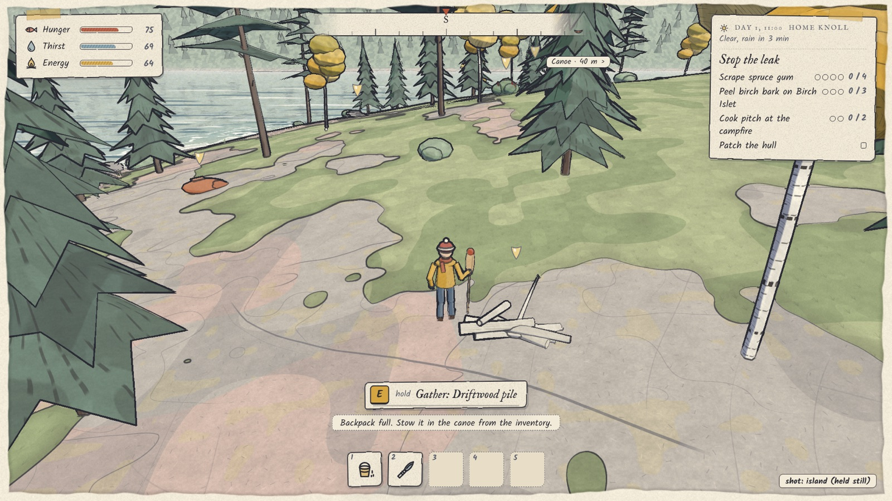

# Portage

A browser survival-crafting game. The valley flooded and stayed flooded. You have a leaky canoe. Paddle between drowned hilltops, scavenge on foot, craft, and bolt what you build onto the canoe until it is a floating homestead.

Working name. Everything on screen is drawn in code: no asset packs, no downloads.

**Play it: https://sigouin.net/portage/** (keyboard and mouse; press F to act, Esc for the menu).





## Where it stands (2026-11-11)

Done:

- The whole main quest is playable, 12 quests from "Bail out" to "The Beacon". A test bot plays it to the end.
- The Ink & Wash look, with the lobby, menus and HUD.
- Sound, made in code.
- The player, the crew and the canoe stay sharp at every zoom and window size.
- Rules for up to 4 players sharing one canoe. Tools belong to the whole crew. Add `?crew=4` to the address to see a crew (the other three stand idle).
- F is the action key, the lantern is on L, and scavenging takes one press.
- A drawn icon beside every item name, 54 in all.
- Each crew member sits in their own seat, wears their own colours, and paddles, bails, sleeps and walks for themselves.
- The canoe: four hull tiers you can tell apart, all 19 attachments, the three survivors.
- The valley: every landmark and scavenge node drawn, all 15 islands told apart by their outline.
- A crew list in the HUD, crewmates on the compass and the map, and notes for the whole crew.
- Weather and night: rain, storm, fog, stars, and light from the lantern, the campfire and the Beacon. Nothing flashes.
- Co-op groundwork: two tabs on one computer play one game (`?host=lake&name=Luc` in one, `?join=lake&name=Sam` in the other).

Next: a relay so friends join by a link, speed on big screens, loose ends, balance, a scored review.

## Run it

Needs Node 22.12 or newer (built and tested on Node 26).

```
npm ci --prefix game
npm run dev --prefix game
```

Then open http://localhost:5220. Keyboard and mouse only for now. How to Play is in the lobby menu.

Publish: `bash deploy/deploy.sh --yes` builds, tests and uploads to sigouin.net/portage, then checks the live copy. Luc's go is needed each time.

Checks:

```
npm run check --prefix game     # typecheck and unit tests
npm ci --prefix e2e
npm test --prefix e2e           # browser tests, needs the dev server running
```

## Where things are

| Path | What |
|---|---|
| `BRIEF.md` | The design, and every call Luc has made |
| `PROMPT.md` | The original ask |
| `game/src/sim/` | The rules engine. Runs with no screen, same inputs give the same game |
| `game/src/look/` | The Ink & Wash look. Guide: `game/LOOK.md` |
| `game/src/interface/` | Lobby, menus and HUD |
| `game/src/client/` | Input, camera, saves, and the glue between the three above |
| `e2e/` | Browser tests that press real keys |
| `art-r1/` | The four art studies the look was picked from |
| `hub/` | Builds a static site with the game, the studies and the reports |

## Bugs and ideas

Open an issue. Say what you did, what you saw, and your window size if it is about the picture.

## Fonts

IM Fell English and Kalam, both under the SIL Open Font Licence. See `game/src/interface/fonts/NOTICE.md`.
